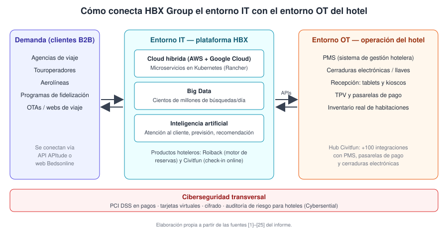

# Informe THD: HBX Group (Hotelbeds)

**Autores:** Manel [apellidos] y Sergi [apellidos]

**Fecha:** 23 de noviembre de 2026

**Módulo:** 1º DAW - DIGI

**Repositorio GitHub:** [https://github.com/byMestral05/informe-thd-hbx-group](https://github.com/byMestral05/informe-thd-hbx-group)

## Índice

1. Datos de la empresa elegida
2. Resumen ejecutivo
3. Análisis THD por THD
    - 3.1 Cloud computing
    - 3.2 Big Data y analítica de datos
    - 3.3 Inteligencia artificial
    - 3.4 Ciberseguridad
    - 3.5 Internet de las cosas (IoT) e integración con sistemas operativos del hotel
    - 3.6 THD que la empresa no utiliza
4. Esquema de integración IT-OT
5. Conclusiones
6. Fuentes

## 1. Datos de la empresa elegida

| Campo | Información |
|---|---|
| **Nombre** | HBX Group (antes Hotelbeds Group) — [www.hbxgroup.com](https://www.hbxgroup.com) |
| **Ubicación** | Sede central en el edificio Mirall, Camí de Son Fangos 100, Palma (Mallorca, Islas Baleares). La empresa nació en Palma en 2001 como parte del grupo Barceló [3]. |
| **Sector concreto** | *TravelTech* B2B: marketplace tecnológico en la nube que conecta hoteles y otros proveedores turísticos con agencias, touroperadores, aerolíneas y programas de fidelización [4]. |
| **Tamaño** | **Grande.** Más de 3.500 empleados, oficinas en 33 países y presencia comercial en más de 170 [1][2][4]. Cotiza en la Bolsa española desde el 13 de febrero de 2025 [2]. |
| **Producto o servicio principal** | **Hotelbeds**, el mayor *bedbank* del mundo, que distribuye más de 180.000 hoteles mediante la API APItude y la web Bedsonline [8][23]. Además vende software para hoteles: **Roiback** (motor de reservas) y **Civitfun** (check-in online), dos empresas también nacidas en Mallorca [4][20]. |
| **Por qué la hemos elegido** | Es la mayor empresa tecnológica con sede en Baleares y su producto es, literalmente, software y datos al servicio del turismo, el motor económico de las islas. |

> **¿Por qué es del sector TIC?** HBX Group no tiene hoteles ni aviones: su negocio es una plataforma digital que recibe cientos de millones de peticiones al día a través de APIs y las cruza con el inventario de los proveedores. La propia empresa se define como «B2B travel technology marketplace» [2][4].

## 2. Resumen ejecutivo

HBX Group es una empresa de software con sede en Palma que actúa como intermediario digital del turismo mundial: los hoteles cargan en su plataforma habitaciones y precios, y miles de agencias y touroperadores los consultan y reservan de forma automática. Su valor depende de responder en milisegundos, con datos fiables y de forma segura, a un volumen enorme de búsquedas.

En este informe identificamos **cinco tecnologías habilitadoras digitales (THD)** presentes en la empresa:

| # | THD | Dónde aparece en HBX Group | Objetivo de negocio al que sirve |
|---|---|---|---|
| 1 | **Cloud computing** | Toda la plataforma de reservas corre en AWS y Google Cloud con contenedores Kubernetes | Escalar sin comprar servidores y responder más rápido |
| 2 | **Big Data** | Procesado de miles de millones de búsquedas, precios y disponibilidad | Saber qué se vende, a quién y a qué precio |
| 3 | **Inteligencia artificial** | Atención al cliente con Google Contact Center AI y Gemini, formación de agentes, recomendación y previsión de demanda | Reducir costes operativos y vender más |
| 4 | **Ciberseguridad** | Pagos conformes a PCI DSS, tarjetas virtuales, firma de peticiones API, servicio Cybersential para hoteles | Generar confianza y cumplir la normativa |
| 5 | **IoT / integración con OT del hotel** | Civitfun conecta la plataforma con PMS, pasarelas de pago y cerraduras electrónicas | Digitalizar la recepción y llegar al hotel físico |

También explicamos qué THD **no** utiliza (blockchain, fabricación aditiva, robótica física, RA/RV) y por qué.

## 3. Análisis THD por THD

### 3.1 Cloud computing

**Definición.** El cloud computing consiste en usar recursos informáticos (servidores, almacenamiento, bases de datos, redes) que ofrece un proveedor a través de Internet y que se pagan según el uso, en lugar de comprarlos e instalarlos en un centro de datos propio.

**Características principales.**

- **Elasticidad / autoescalado:** la capacidad sube o baja sola según la carga.
- **Pago por uso:** se convierte un gasto de inversión (comprar servidores) en un gasto operativo.
- **Modelos de servicio IaaS, PaaS y SaaS**, y despliegue público, privado o **híbrido**.

**Aplicación en HBX Group.**

- **Migración progresiva desde centros de datos propios.** Hotelbeds empezó a migrar a **Amazon Web Services (AWS)**, con el apoyo de BT para la parte de red y centro de datos. En 2018 ya tenía más del 60 % de sus datos en AWS y explicaba que el objetivo era atender más rápido las más de **430 millones de peticiones diarias** que recibía [5][6].
- **Segundo proveedor: Google Cloud.** En 2021 llevó su plataforma de API a Google Cloud con una arquitectura de **autoescalado** e **infraestructura como código**. Según la empresa, los clientes de la API vieron bajar los tiempos de respuesta **hasta un 7 %**, lo que mejora la conversión de las búsquedas en reservas [7].
- **Contenedores y Kubernetes.** Desde 2017 la empresa pasó de máquinas virtuales a una arquitectura de **microservicios en contenedores Docker**. En 2020 puso en producción clústeres **Kubernetes** gestionados con **Rancher**, a la vez en sus servidores propios (*on-premise*), en Google Cloud y en AWS. Con ello redujo un **90 % el tiempo de migración** a la nube y un **80 % el tiempo de despliegue** de clústeres [8].
- **SaaS interno.** Para la gestión corporativa usa aplicaciones SaaS como Workday, Microsoft y Salesforce [5].

**Mejora IT/OT que aporta.**

- **IT:** la plataforma deja de depender de la capacidad física de un centro de datos en Palma. En temporada alta (verano europeo, Black Friday) puede multiplicar recursos y luego reducirlos, en vez de dimensionar servidores para el pico todo el año.
- **IT-OT:** al estar en la nube, el inventario que el hotel actualiza en su sistema operativo (PMS o *channel manager*) llega casi en tiempo real a miles de agencias de todo el mundo. La nube actúa como **punto de encuentro** entre la operación física del hotel y la venta digital.

### 3.2 Big Data y analítica de datos

**Definición.** Big Data es el conjunto de técnicas y herramientas para capturar, almacenar y analizar volúmenes de datos tan grandes, rápidos o variados que no se pueden tratar con una base de datos tradicional.

**Características principales (las «V»).**

- **Volumen:** cantidades masivas de registros.
- **Velocidad:** datos que llegan en flujo continuo y deben procesarse casi en tiempo real.
- **Variedad:** datos estructurados (precios, reservas) y no estructurados (descripciones, fotos, conversaciones).

**Aplicación en HBX Group.**

- **Volumen y velocidad reales.** Ya en 2016 el CTO afirmaba que recibían **más de 6.000 peticiones por segundo** y que «Big Data is business as usual» para ellos; ese año presentaron su **Big Data Platform** en el AWS Summit de Madrid [9]. En 2020, tras rediseñar el portal de su API, APItude podía soportar **hasta 14.000 millones de búsquedas al día** en los picos [10].
- **Peso del canal API.** Hosteltur recogía que APItude ya suponía el 20 % del negocio de Hotelbeds, con más de 400 clientes y 80 millones de búsquedas diarias, dentro de un total de unos 300 millones de búsquedas al día [24].
- **Herramientas que usan.** Las ofertas de empleo de la empresa piden experiencia en **Kafka** (flujos de datos en tiempo real), **PostgreSQL**, **Redis** (caché), **Tableau** (*Business Intelligence*) y **AWS SageMaker** (modelos de machine learning) [11]. Otra oferta busca un *Data Engineer Lead* para diseñar **pipelines de datos** y desplegar modelos de ML [12]. Esto confirma que el análisis de datos es una actividad diaria con equipo propio.
- **Producto de datos para clientes.** La **Cache API** permite a los clientes descargar ficheros masivos de precios y disponibilidad en lugar de consultar uno a uno, y la **Content API** sirve información estática (fotos, descripciones, servicios) de más de 180.000 hoteles en varios idiomas [23].
- **Ejemplo concreto:** en un datatón con el IE, Hotelbeds cedió datos reales de su negocio de traslados y actividades para **segmentar clientes** y atenderlos mejor [9].

**Mejora IT/OT que aporta.**

- **IT:** decisiones de precios, catálogo y comerciales basadas en datos y no en intuición.
- **IT-OT:** los datos de búsquedas (por ejemplo, un aumento de búsquedas desde un mercado emisor concreto) se devuelven al hotel para que ajuste su operación: personal, apertura de plantas o precios. Es el caso de uso de la alianza con Vorsee descrita en el apartado 3.3 [16].

### 3.3 Inteligencia artificial

**Definición.** La inteligencia artificial (IA) agrupa las técnicas que permiten a un sistema realizar tareas que normalmente requieren inteligencia humana: entender lenguaje, reconocer patrones, predecir o tomar decisiones. Incluye el *machine learning* y la IA generativa.

**Características principales.**

- **Aprende de los datos:** los modelos mejoran con más ejemplos, así que depende del Big Data.
- **Automatiza tareas cognitivas** repetitivas, como responder consultas o clasificar casos.
- **Predice y recomienda:** estima demanda, precios o qué producto encaja con un cliente.

**Aplicación en HBX Group.**

- **Atención al cliente «AI-first».** En junio de 2024 anunció un nuevo modelo de atención basado en **Google Cloud Contact Center AI** y los modelos **Gemini**, desarrollado con la consultora Emergya. Se usa para automatizar tareas rutinarias, reducir tiempos de respuesta y ayudar a los agentes humanos con respuestas a medida [13]. Es relevante porque la empresa tiene **más de 1.000 agentes de soporte** que atienden en 13 idiomas [1].
- **Entrenador con IA para agentes.** En diciembre de 2024 lanzó un simulador que genera conversaciones con clientes ficticios en **13 idiomas**, con **cientos de escenarios** y **cuatro niveles de dificultad**, para que los nuevos agentes practiquen sin un formador presente [14].
- **Recomendación personalizada.** En mayo de 2026 acordó comprar la startup **Bridgify** por unos 3 millones de euros. Su software empareja más de **un millón de experiencias** turísticas con el perfil de cada viajero. Según Skift, la IA y la automatización ya le han supuesto **ahorros anualizados de 1 millón de euros** y un **5 % menos de costes operativos** [15].
- **Previsión de demanda para hoteles.** Mediante una alianza con **Vorsee** (plataforma ActionOS), integra agentes de IA predictiva en su Partner Portal, en Roiback y en Civitfun para que los hoteles detecten cambios de demanda **antes** de que aparezcan en sus reservas [16].

**Mejora IT/OT que aporta.**

- **IT:** menos carga manual en el centro de atención y respuestas más rápidas a agencias y hoteles.
- **IT-OT:** la previsión de demanda pasa de ser un informe a una **acción operativa** en el hotel: cambiar precios, reforzar personal de recepción o abrir más habitaciones. La IA conecta lo que ocurre en la plataforma digital con la gestión física del alojamiento.

### 3.4 Ciberseguridad

**Definición.** La ciberseguridad es el conjunto de medidas técnicas, organizativas y legales que protegen sistemas, redes y datos frente a accesos no autorizados, robos, fraudes o interrupciones del servicio.

**Características principales.**

- **Confidencialidad, integridad y disponibilidad** (tríada CIA) de la información.
- **Cumplimiento normativo:** estándares como **PCI DSS** para datos de tarjetas y el RGPD para datos personales.
- **Defensa en capas:** autenticación, cifrado, monitorización y formación de las personas.

**Aplicación en HBX Group.**

- **Pagos.** Mueve millones de reservas con tarjeta, por lo que su motor de reservas cumple **PCI DSS**. A los proveedores les paga con **tarjetas de crédito virtuales (VCC)**, gestionadas con un sistema de facturación electrónica, y aplica capas de cifrado en el recorrido del pago [17].
- **Acceso a la API.** Cada cliente que se conecta a APItude se autentica con una **clave de API** y una **firma** generada a partir de su clave, un secreto y la marca de tiempo. Así se evita que alguien reutilice o falsifique peticiones [23].
- **Ciberseguridad como servicio para hoteles.** En junio de 2025 lanzó con la aseguradora Wallbid **Cybersential**: una auditoría que revisa la infraestructura digital del hotel, detecta vulnerabilidades (credenciales expuestas, sistemas sin proteger), le asigna una **puntuación de riesgo** con recomendaciones y le da la opción de contratar un **ciberseguro** [18].
- **Concienciación.** Su directora de Tecnología y Datos defendía públicamente en 2024 la colaboración y la formación en ciberseguridad dentro de la cadena turística [19].

**Mejora IT/OT que aporta.**

- **IT:** protege la plataforma y los datos de millones de viajeros, condición imprescindible para que agencias y bancos confíen en ella.
- **IT-OT:** el punto débil del turismo suele ser el hotel (recepción, PMS antiguo, wifi de huéspedes). Con Cybersential, HBX **extiende la seguridad desde su plataforma IT hasta los sistemas operativos del hotel**, que es justamente donde conviven IT y OT.

### 3.5 Internet de las cosas (IoT) e integración con sistemas operativos del hotel

**Definición.** El Internet de las cosas (IoT) es la conexión a Internet de objetos físicos (sensores, cerraduras, terminales) para que envíen datos y se puedan controlar a distancia o de forma automática desde software.

**Características principales.**

- **Conectividad de dispositivos físicos** con plataformas en la nube.
- **Automatización:** un evento digital provoca una acción física (por ejemplo, activar una llave).
- **Interoperabilidad:** necesita integraciones y protocolos comunes entre fabricantes distintos.

**Aplicación en HBX Group.** Aquí hay que ser precisos: **HBX Group no fabrica dispositivos IoT**. Su papel es **integrar** su software con los dispositivos y sistemas que ya hay en el hotel. Lo hace sobre todo con **Civitfun**, empresa fundada en Mallorca en 2014 y comprada por HBX en mayo de 2025 [20]:

- Civitfun dispone de un **hub con más de 100 integraciones** con PMS, pasarelas de pago y **cerraduras electrónicas** [21][25].
- Ha procesado **15 millones de check-ins** en más de **3.500 hoteles** y 500.000 habitaciones [21].
- El huésped puede hacer el check-in desde el móvil (por URL, sin descargar una app) o en la recepción con una tablet (solución *Paperless*). Los datos pasan directamente al PMS y, según el hotel, se puede emitir la llave digital [22][25].
- Según Roiback, la implantación tarda **unos 15 días** y el sistema reduce el fraude y las devoluciones [22].

**Mejora IT/OT que aporta.** Es la THD que **más directamente une IT y OT**:

- La reserva nace en la plataforma IT de HBX (APItude o Bedsonline).
- Llega al **PMS** del hotel, el sistema que gestiona la operación diaria.
- Con Civitfun, el **registro del huésped**, el **pago** y la **llave** (dispositivos físicos) se activan a partir de esos mismos datos, sin volver a teclearlos en recepción.

Resultado: menos colas, menos errores de transcripción y una sola fuente de verdad desde la reserva hasta la puerta de la habitación.

### 3.6 THD que la empresa no utiliza (o no de forma relevante)

| THD | ¿La usa? | Motivo |
|---|---|---|
| **Blockchain** | No hemos encontrado uso en producción | Su negocio necesita confirmar miles de reservas por segundo; una cadena de bloques añadiría latencia y coste sin aportar mucho, porque HBX ya actúa como intermediario de confianza. |
| **Fabricación aditiva (impresión 3D)** | No | No fabrica productos físicos. |
| **Robótica física** | No | No tiene operaciones logísticas ni de fabricación. La automatización que usa es de software (IA y automatización de procesos). |
| **Realidad aumentada / virtual** | No como producto principal | Las agencias venden con fotos y descripciones de la Content API; no hemos encontrado fuentes que muestren RA/RV en su plataforma. |

## 4. Esquema de integración IT-OT

**Cómo leer el esquema.** A la izquierda, la **demanda**: agencias, touroperadores y aerolíneas que buscan y reservan. En el centro, el **entorno IT** de HBX: nube híbrida, Big Data e IA. A la derecha, el **entorno OT** del hotel: PMS, cerraduras, recepción y pagos. Las **APIs** (APItude y el hub de Civitfun) son los puentes entre ambos lados, y la **ciberseguridad** atraviesa todo el flujo.

**Resumen de la mejora IT-OT por THD**

| THD | Mejora en IT | Mejora en la integración IT-OT |
|---|---|---|
| Cloud | Escalado automático y despliegues un 80 % más rápidos | El inventario del hotel se publica al mundo casi en tiempo real |
| Big Data | Decisiones basadas en datos | Las señales de demanda vuelven al hotel para planificar la operación |
| IA | Atención al cliente automatizada | La previsión se convierte en acciones en el hotel (precio, personal) |
| Ciberseguridad | Plataforma y pagos protegidos (PCI DSS) | Auditoría de riesgo de los sistemas del propio hotel |
| IoT / integración | Un único flujo de datos | Reserva → PMS → check-in → llave, sin papel |

## 5. Conclusiones

La THD **más determinante** para el modelo de negocio de HBX Group es el **cloud computing**, por tres motivos:

1. **Sin nube no hay producto.** HBX no vende habitaciones propias: vende acceso inmediato a un inventario mundial. Atender cientos de millones de peticiones diarias con picos de miles de millones de búsquedas [6][10] solo es viable con una infraestructura elástica. La propia empresa relaciona la migración con poder responder más rápido [5], y Google Cloud con una mejora de hasta el 7 % en tiempos de respuesta y, por tanto, en conversión [7].
2. **Es la base de las demás THD.** El Big Data (Kafka, SageMaker), la IA (Contact Center AI, Gemini) y los productos SaaS para hoteles (Roiback, Civitfun) se apoyan en esa infraestructura en la nube. Sin ella, cada una de esas tecnologías exigiría montar su propio centro de datos.
3. **Es el punto de encuentro entre IT y OT.** Hoteles de 170 países conectan sus sistemas operativos a la plataforma y miles de agencias consumen esos datos desde el mismo lugar.

Dicho esto, observamos una **tendencia clara hacia la IA**: entre 2024 y 2026 la empresa ha pasado de usarla en atención al cliente a comprar startups de IA (Bridgify) y a ofrecer predicción de demanda a los hoteles (Vorsee) [13][15][16]. Si la tendencia sigue, la IA podría convertirse en su principal diferencial competitivo, aunque siempre sobre la base de la nube.

Para Baleares, el caso de HBX Group demuestra que la digitalización del turismo no consiste solo en tener web. Una empresa nacida en Palma ha convertido la **intermediación turística, que antes se hacía en papel, por fax y por teléfono**, en una plataforma de datos global.

## 6. Fuentes

Todas las fuentes se consultaron el 23 de noviembre de 2026. Las cifras citadas son las publicadas por cada fuente en su fecha.

**Cobertura de fuentes por THD:** Cloud [5][6][7][8] · Big Data [9][10][11][12][24] · IA [13][14][15][16] · Ciberseguridad [17][18][19][23] · IoT/integración [20][21][22][25].

**Empresa (datos generales)**

- **[1]** HBX Group. *About us*. https://hbxgroup.com/about-us
- **[2]** BME – Bolsas y Mercados Españoles (2025). *BME welcomes HBX Group*. https://www.bolsasymercados.es/en/media/press-releases/2025/bme-welcomes-hbx-group.html
- **[3]** Marketing4ecommerce (2025). *Qué es Hotelbeds: claves de un gigante digital español*. https://marketing4ecommerce.net/que-es-hotelbeds/
- **[4]** HBX Group (2026). *HBX Group report shows AI adoption grows across travel distribution*. https://www.hbxgroup.com/news-room/press-release/hbx-group-report-shows-ai-adoption-grows-across-travel

**Cloud computing**

- **[5]** HBX Group. *Hotelbeds Group reaches landmark phase in transition to the cloud* (nota de prensa). https://hbxgroup.com/news-room/press-release/hotelbeds-group-reaches-landmark-phase-transition-cloud
- **[6]** Travolution. *Hotelbeds hails 'landmark' in cloud migration*. https://travolution.com/articles/101310/hotelbeds-hails-landmark-in-cloud-migration
- **[7]** HBX Group (2021). *Hotelbeds chooses Google Cloud to help fuel recovery*. https://www.hbxgroup.com/news-room/press-release/hotelbeds-chooses-google-cloud-help-fuel-recovery
- **[8]** SUSE / Rancher (2020). *Connecting the World's Travel Trade with Kubernetes*. https://www.suse.com/blog/connecting-the-worlds-travel-trade-with-kubernetes/

**Big Data**

- **[9]** HBX Group (2016). *Hotelbeds Group brings travel Big Data to IE University's Datathon*. https://hbxgroup.com/news-room/press-release/hotelbeds-group-brings-travel-big-data-ie-university%E2%80%99s-datathon
- **[10]** Hotelbeds (2020). *Innovative API portal launch for APItude*. https://discover.hotelbeds.com/resources/travel-room/innovative-api-portal-launch-apitude
- **[11]** Built In. *Principal Solution Architect – HBX Group* (oferta de empleo). https://builtin.com/job/principal-solution-architect/7557195
- **[12]** Built In. *Data Engineer Lead – HBX Group* (oferta de empleo). https://builtin.com/job/data-engineer-lead/7557731

**Inteligencia artificial**

- **[13]** HBX Group (2024). *HBX Group to revolutionise customer service with cutting-edge AI*. https://www.hbxgroup.com/news-room/press-release/hbx-group-revolutionise-customer-service-cutting-edge-ai
- **[14]** HBX Group (2024). *HBX Group launches AI trainer to streamline and optimise training*. https://hbxgroup.com/news-room/press-release/hbx-group-launches-ai-trainer-streamline-and-optimise-training
- **[15]** Skift (2026). *El Grupo HBX adquirirá Bridgify como parte de una estrategia más amplia de impulso de la IA*. https://skift.com/es/2026/05/13/hbx-group-to-buy-bridgify-as-part-of-broader-ai-push/
- **[16]** Travel Daily News (2026). *HBX Group partners with Vorsee on predictive AI for hotels*. https://www.traveldailynews.com/technology/hbx-group-partners-with-vorsee-on-predictive-ai-for-hotels/

**Ciberseguridad**

- **[17]** Hotelbeds. *Cybersecurity: Staying safe in a digital booking landscape as travel distributors*. https://discover.hotelbeds.com/resources/cybersecurity-staying-safe-digital-booking-landscape-travel-providers
- **[18]** Hospitality Net (2025). *HBX Group launches in Europe Cyber Risk Assessment service with Wallbid for hotels*. https://www.hospitalitynet.org/news/4127846.html
- **[19]** Hotelbeds (2024). *Cybersecurity in hotels*. https://discover.hotelbeds.com/resources/insight/cybersecurity-hotels

**IoT / integración con el hotel**

- **[20]** HBX Group (2025). *HBX Group integrates Civitfun into its portfolio to digitalise hotel operations*. https://www.hbxgroup.com/news-room/press-release/hbx-group-integrates-civitfun-its-portfolio-digitalise-hotel
- **[21]** HBX Group. *Civitfun* (ficha de marca). https://www.hbxgroup.com/civitfun-brand
- **[22]** Roiback Academy. *Digitize your reception: less queues, more data and more satisfaction*. https://en.roiback.com/rb-academy/digitize-your-reception-less-queues-more-data-and-more-satisfaction
- **[25]** HBX Group. *Hotel digitalisation and transformation*. https://www.hbxgroup.com/resources/articles/hotel-digitalisation-transformation

**Documentación técnica (transversal)**

- **[23]** HBX Group / Hotelbeds. *APItude – Developer portal* (documentación de Booking, Content y Cache API). https://developer.hotelbeds.com/
- **[24]** Hosteltur. *Hotelbeds abrirá nuevos data centers en América*. https://www.hosteltur.com/lat/111270_hotelbeds-abrira-nuevos-data-centers-america.html
