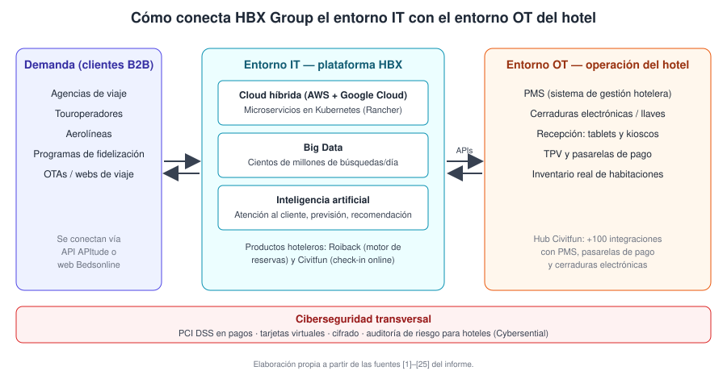

## 4. Esquema de integración IT-OT

**Cómo leer el esquema.** A la izquierda, la **demanda**: agencias, touroperadores y aerolíneas que buscan y reservan. En el centro, el **entorno IT** de HBX: nube híbrida, Big Data e IA. A la derecha, el **entorno OT** del hotel: PMS, cerraduras, recepción y pagos. Las **APIs** (APItude y el hub de Civitfun) son los puentes entre ambos lados, y la **ciberseguridad** atraviesa todo el flujo.

**Resumen de la mejora IT-OT por THD**

| THD | Mejora en IT | Mejora en la integración IT-OT |
|---|---|---|
| Cloud | Escalado automático y despliegues un 80 % más rápidos | El inventario del hotel se publica al mundo casi en tiempo real |
| Big Data | Decisiones basadas en datos | Las señales de demanda vuelven al hotel para planificar la operación |
| IA | Atención al cliente automatizada | La previsión se convierte en acciones en el hotel (precio, personal) |
| Ciberseguridad | Plataforma y pagos protegidos (PCI DSS) | Auditoría de riesgo de los sistemas del propio hotel |
| IoT / integración | Un único flujo de datos | Reserva → PMS → check-in → llave, sin papel |

## 5. Conclusiones

La THD **más determinante** para el modelo de negocio de HBX Group es el **cloud computing**, por tres motivos:

1. **Sin nube no hay producto.** HBX no vende habitaciones propias: vende acceso inmediato a un inventario mundial. Atender cientos de millones de peticiones diarias con picos de miles de millones de búsquedas [6][10] solo es viable con una infraestructura elástica. La propia empresa relaciona la migración con poder responder más rápido [5], y Google Cloud con una mejora de hasta el 7 % en tiempos de respuesta y, por tanto, en conversión [7].
2. **Es la base de las demás THD.** El Big Data (Kafka, SageMaker), la IA (Contact Center AI, Gemini) y los productos SaaS para hoteles (Roiback, Civitfun) se apoyan en esa infraestructura en la nube. Sin ella, cada una de esas tecnologías exigiría montar su propio centro de datos.
3. **Es el punto de encuentro entre IT y OT.** Hoteles de 170 países conectan sus sistemas operativos a la plataforma y miles de agencias consumen esos datos desde el mismo lugar.

Dicho esto, observamos una **tendencia clara hacia la IA**: entre 2024 y 2026 la empresa ha pasado de usarla en atención al cliente a comprar startups de IA (Bridgify) y a ofrecer predicción de demanda a los hoteles (Vorsee) [13][15][16]. Si la tendencia sigue, la IA podría convertirse en su principal diferencial competitivo, aunque siempre sobre la base de la nube.

Para Baleares, el caso de HBX Group demuestra que la digitalización del turismo no consiste solo en tener web. Una empresa nacida en Palma ha convertido la **intermediación turística, que antes se hacía en papel, por fax y por teléfono**, en una plataforma de datos global.

## 6. Fuentes

Todas las fuentes se consultaron el 23 de noviembre de 2026. Las cifras citadas son las publicadas por cada fuente en su fecha.

**Cobertura de fuentes por THD:** Cloud [5][6][7][8] · Big Data [9][10][11][12][24] · IA [13][14][15][16] · Ciberseguridad [17][18][19][23] · IoT/integración [20][21][22][25].

**Empresa (datos generales)**

- **[1]** HBX Group. *About us*. https://hbxgroup.com/about-us
- **[2]** BME – Bolsas y Mercados Españoles (2025). *BME welcomes HBX Group*. https://www.bolsasymercados.es/en/media/press-releases/2025/bme-welcomes-hbx-group.html
- **[3]** Marketing4ecommerce (2025). *Qué es Hotelbeds: claves de un gigante digital español*. https://marketing4ecommerce.net/que-es-hotelbeds/
- **[4]** HBX Group (2026). *HBX Group report shows AI adoption grows across travel distribution*. https://www.hbxgroup.com/news-room/press-release/hbx-group-report-shows-ai-adoption-grows-across-travel

**Cloud computing**

- **[5]** HBX Group. *Hotelbeds Group reaches landmark phase in transition to the cloud* (nota de prensa). https://hbxgroup.com/news-room/press-release/hotelbeds-group-reaches-landmark-phase-transition-cloud
- **[6]** Travolution. *Hotelbeds hails 'landmark' in cloud migration*. https://travolution.com/articles/101310/hotelbeds-hails-landmark-in-cloud-migration
- **[7]** HBX Group (2021). *Hotelbeds chooses Google Cloud to help fuel recovery*. https://www.hbxgroup.com/news-room/press-release/hotelbeds-chooses-google-cloud-help-fuel-recovery
- **[8]** SUSE / Rancher (2020). *Connecting the World's Travel Trade with Kubernetes*. https://www.suse.com/blog/connecting-the-worlds-travel-trade-with-kubernetes/

**Big Data**

- **[9]** HBX Group (2016). *Hotelbeds Group brings travel Big Data to IE University's Datathon*. https://hbxgroup.com/news-room/press-release/hotelbeds-group-brings-travel-big-data-ie-university%E2%80%99s-datathon
- **[10]** Hotelbeds (2020). *Innovative API portal launch for APItude*. https://discover.hotelbeds.com/resources/travel-room/innovative-api-portal-launch-apitude
- **[11]** Built In. *Principal Solution Architect – HBX Group* (oferta de empleo). https://builtin.com/job/principal-solution-architect/7557195
- **[12]** Built In. *Data Engineer Lead – HBX Group* (oferta de empleo). https://builtin.com/job/data-engineer-lead/7557731

**Inteligencia artificial**

- **[13]** HBX Group (2024). *HBX Group to revolutionise customer service with cutting-edge AI*. https://www.hbxgroup.com/news-room/press-release/hbx-group-revolutionise-customer-service-cutting-edge-ai
- **[14]** HBX Group (2024). *HBX Group launches AI trainer to streamline and optimise training*. https://hbxgroup.com/news-room/press-release/hbx-group-launches-ai-trainer-streamline-and-optimise-training
- **[15]** Skift (2026). *El Grupo HBX adquirirá Bridgify como parte de una estrategia más amplia de impulso de la IA*. https://skift.com/es/2026/05/13/hbx-group-to-buy-bridgify-as-part-of-broader-ai-push/
- **[16]** Travel Daily News (2026). *HBX Group partners with Vorsee on predictive AI for hotels*. https://www.traveldailynews.com/technology/hbx-group-partners-with-vorsee-on-predictive-ai-for-hotels/

**Ciberseguridad**

- **[17]** Hotelbeds. *Cybersecurity: Staying safe in a digital booking landscape as travel distributors*. https://discover.hotelbeds.com/resources/cybersecurity-staying-safe-digital-booking-landscape-travel-providers
- **[18]** Hospitality Net (2025). *HBX Group launches in Europe Cyber Risk Assessment service with Wallbid for hotels*. https://www.hospitalitynet.org/news/4127846.html
- **[19]** Hotelbeds (2024). *Cybersecurity in hotels*. https://discover.hotelbeds.com/resources/insight/cybersecurity-hotels

**IoT / integración con el hotel**

- **[20]** HBX Group (2025). *HBX Group integrates Civitfun into its portfolio to digitalise hotel operations*. https://www.hbxgroup.com/news-room/press-release/hbx-group-integrates-civitfun-its-portfolio-digitalise-hotel
- **[21]** HBX Group. *Civitfun* (ficha de marca). https://www.hbxgroup.com/civitfun-brand
- **[22]** Roiback Academy. *Digitize your reception: less queues, more data and more satisfaction*. https://en.roiback.com/rb-academy/digitize-your-reception-less-queues-more-data-and-more-satisfaction
- **[25]** HBX Group. *Hotel digitalisation and transformation*. https://www.hbxgroup.com/resources/articles/hotel-digitalisation-transformation

**Documentación técnica (transversal)**

- **[23]** HBX Group / Hotelbeds. *APItude – Developer portal* (documentación de Booking, Content y Cache API). https://developer.hotelbeds.com/
- **[24]** Hosteltur. *Hotelbeds abrirá nuevos data centers en América*. https://www.hosteltur.com/lat/111270_hotelbeds-abrira-nuevos-data-centers-america.html
